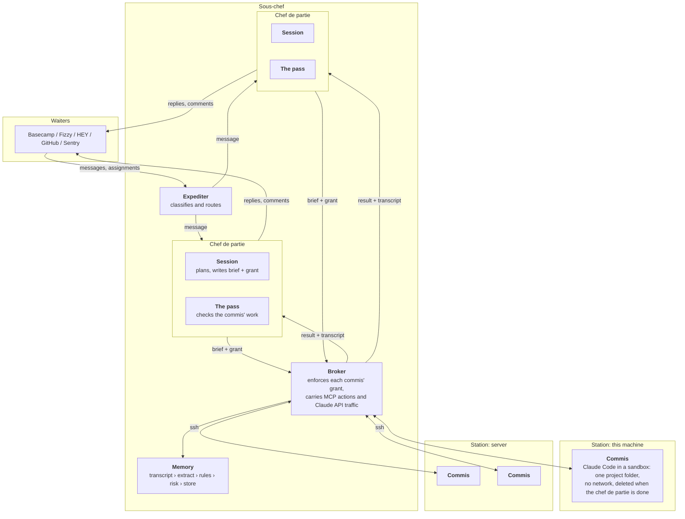

# SOUS-CHEF

sous-chef is a harness for a self-governing, token-efficient agent that you
work with through Basecamp, HEY, Fizzy, or anything else the way you
would with a human colleague.

It uses your regular Claude Code subscription, runs all work in sandboxes —
on this machine or on others you give it — can rotate between several
Claude subscriptions, and learns and improves over time while staying
token-efficient.


> [!WARNING]
> sous-chef is experimental. This is just an idea I'm playing around with.
> Consider all of this a giant Rube Goldberg machine that's actively
> being tweaked.

## Setting it up

Before you start, you need Claude Code installed and at least one active
subscription for it.

The easiest way to install sous-chef is through [mise](https://mise.jdx.dev):

```bash
mise use -g github:monorkin/sous-chef
```

On [Omarchy](https://omarchy.org):

```bash
omarchy-mise-install github:monorkin/sous-chef sous-chef
```

Once installed, start the setup. It guides you through everything, including
what the agent is called and logging it in to Claude with an account of its own:

```bash
sous-chef setup
```

## Upgrading

```bash
sous-chef upgrade           # to the latest release
sous-chef upgrade 0.2.0     # or to a specific one
```

## Usage

```bash
# Running
sous-chef start                                # start in the background (through systemd, if setup installed the service)
sous-chef stop                                 # stop sous-chef and everything it started
sous-chef restart                              # stop and start; every turn picks up where it was
sous-chef status
sous-chef poke basecamp                        # check a waiter now instead of at the next tick; hook this to webhooks, mail filters, cron
sous-chef run                                  # or run in this terminal until ctrl+c
sous-chef chat "the deploy is red, have a look" # or talk to the agent from this terminal
sous-chef chat --conversation billing "..."    # each conversation gets its own chef de partie
sous-chef log -f                               # watch what the agent is doing

# Backups
sous-chef backup                               # everything in one zip; safe while it runs
sous-chef backup --to ~/sous-chef.zip --without-secrets
sous-chef restore ~/sous-chef.zip              # sous-chef has to be stopped; --force replaces what is set up here

# MCP servers: how the agent acts, and where it listens
sous-chef mcp add basecamp -- basecamp mcp     # also accepts a server's changed tools
sous-chef mcp list
sous-chef mcp prose basecamp create_comment content   # this argument is prose for people: restyle it
sous-chef mcp remove basecamp
sous-chef waiter check basecamp               # read a waiter once and show what the agent would make of it, without acting

# Stations: other machines commis can work on
sous-chef station add server user@server.example.com   # installs what a commis needs and sends a test commis
sous-chef station list
sous-chef station check server
sous-chef station remove server

# Claude accounts: the subscriptions it rotates between
sous-chef claude login                         # log the agent in again, in the browser; setup does this the first time
sous-chef claude account add                   # add the current Claude Code account to the rotation
sous-chef claude account remove email@example.com
sous-chef claude account list

# Memory
sous-chef memory list
sous-chef memory archive [memory-id]
```

## Architecture

sous-chef is organized like a kitchen, the naming can be confusing so here's an explainer:

| Name | What it is in sous-chef | Why |
|---|---|---|
| **Chef** | You, the person the agent works for. | Sets the menu and gives the orders. |
| **Sous-chef** | This harness | Runs the kitchen on the chef's behalf. |
| **Waiters** | Where messages come from and replies go back to: Basecamp, HEY, Fizzy, GitHub, Sentry. One message is a ticket. | Bring orders in as tickets, and carry the plates back out. |
| **Expediter** | Takes each ticket and calls it to the chef de partie that owns it, or it employs a new one. | Reads every ticket and calls it to the right station. |
| **Chef de partie** | Owns and plans the work, writes the briefs and sends commis to do it. | Owns one order from start to finish. |
| **Commis** | A sandboxed Claude Code session that does the actual work in one project folder, and reports back. | The junior cook who does the prep, under a chef de partie. |
| **Station** | A machine a commis works on | Where a commis works. |
| **The pass** | Checks a commis's work before the chef de partie hears about it, and sends back only a verdict. | Every plate is checked there before it goes out. |
| **Taster** | Screens what comes in for manipulation, and scores the style of what goes out. | Tastes everything before it's served or used. |
| **Plating** | Restyles outgoing prose to your style before it is posted, without changing what it says. | Makes a dish presentable without changing the dish. |

Or in the from of a graph:



A commis can only talk to its chef de partie. It has very limited disk
access and no internet access besides localhost, whichever station it works
at. Everything it does beyond the sandbox goes through an MCP request that a
broker arbitrates.

A commis at another station works the same way. Its project goes there by
git and its commits come back; the broker and the Claude proxy stay here,
carried over one ssh connection, so what a commis may reach is still decided
on this machine.

Commis run in [bubblewrap](https://github.com/containers/bubblewrap) and
reach their services through `socat`, so install both from your distribution.

If [mr-boxington](https://mr-boxington.jdx.dev) is among your global mise
tools, commis build Rust through it, with a cache of their own.

## Building

```bash
mise trust && mise install         # rust, mr-boxington, cross, and gh, from mise.toml
cargo build --release              # → target/release/sous-chef
sudo make install                  # → /usr/bin/sous-chef
```

A local `make install` just needs the host toolchain. With mise, cargo runs
through [mr-boxington](https://mr-boxington.jdx.dev), so git worktrees and
sibling checkouts share compiled crates instead of each growing a full
`target/`.

Cutting a release (`make release`, or `make build-all` on its own)
cross-builds static musl binaries for amd64 and arm64, which needs
[`cross`](https://github.com/cross-rs/cross) and a running Docker or Podman:

```bash
make release        # builds both targets, publishes the GitHub release
```

`Cross.toml` pins the `:main` cross images — the default pinned images ship a
glibc too old to run a current rustc's build scripts.

## License

MIT — see [LICENSE](LICENSE).
